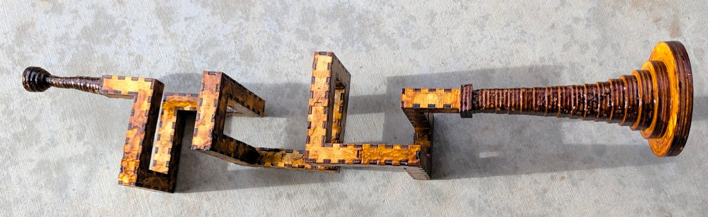

# Trumpet, elbows allowed

**[← All projects](https://gernreich.github.io/)**

<!-- readme-only -->
**[Read the writeup](https://gernreich.github.io/trumpet-elbows-allowed/)** ·
**[Turn the built trumpet in 3D](https://gernreich.github.io/trumpet-elbows-allowed/built/coil-fold2-long-straight-3t/fold2-long-straight-3t.html)**

<!-- page-only **[Read the README](https://github.com/Gernreich/trumpet-elbows-allowed)** · **[Turn the built trumpet in 3D on a page of its own](built/coil-fold2-long-straight-3t/fold2-long-straight-3t.html)** -->

<!-- page-only <iframe src="built/coil-fold2-long-straight-3t/fold2-long-straight-3t.html?embed" title="The built three-turn trumpet bore: 1096 mm of 10 mm square section coiling three whole turns about one axis, drawn as a chain of coloured blocks you can drag to turn" style="width:100%;height:560px;border:0"></iframe> -->

A trumpet cut flat from 3 mm birch ply and press-fit into a tube. The airway is a
**10 mm square** running through **16 mm blocks** — 10 mm of air inside 3 mm walls —
and it never changes section from the mouthpiece to the throat of the bell.

The instrument that has been built is a **coil of 1096 mm in 12 sections**, with a
**72 mm** mouthpiece at one end and a 153 mm bell at the other. It winds 1080° —
**three** turns, right-handed, about a north–south axis. Everything else here is
a candidate for the next one.

Every bore here is a **walk through a grid of cubes**, the kind of trumpet you
could build in Minecraft. The same trumpet swept along a smooth curve instead,
with no grid and no elbows, is its own repository:
**[swept-curve](https://gernreich.github.io/swept-curve/)**, which holds the built spiral bore and every
swept-curve design. Both take the bell and the mouthpiece kept here.

The mouthpiece on this instrument is 24 rings where the design cuts 30 — 72 mm
rather than 90 — so it is the instrument that is short, not the drawing. The
coil winds three whole turns: its walk is `W U E D` three times over, and its
first and last blocks sit on the same cross-section point, which a fractional
number of turns cannot do.



---

## The idea

A brass instrument is a long tube you have to fit into a small space. A trumpet
could be done with three tight bends and a lot of drawn brass. This does it by
**treating the tube as a walk through a lattice of cubes** — north three, up two,
east three — and cutting each run of that walk as a flat-packed box.

The walk is written down. `N1 W3 U2 E3 N3 D3 W2 U3 N3 E3 D2 W3 N3 U3 E2 D3 N1`
is the bore of the built instrument: the first term is the direction you enter
from and how far you go before anything turns, and every term after it turns
where you stand and then moves that many blocks. A generator turns that string
into cut files, checks them, and tells you what you are holding.

```
target/release/bore_split "N1 W3 U2 E3 N3 D3 W2 U3 N3 E3 D2 W3 N3 U3 E2 D3 N1" \
    --bore=10 --straight=30 --no-write
```

**A turn costs no block.** It happens inside the block you arrived at, and you
start in block 1 rather than in front of it, so the tube is `1 + the sum of the
numbers` blocks long. Forty-three steps, forty-four blocks.

## What decides a good bore

Three things, and they pull against each other.

**Length, because length is pitch.** A tube twice as long sounds an octave
lower. The four coils in `parts/bore/concept/walk/coil/fold2-long-straight/`
are one shape cut at four lengths — **274, 548, 822 and 1096 mm, an exact
1:2:3:4** — and the built instrument is the longest of them.

> Their folder names say 0.75, 1.5, 2.25 and 3 turns, and measurement agrees:
> the four sweep 270°, 540°, 810° and 1080° about the coil axis, one group of
> three lateral legs being three-quarters of a turn. Both the lengths and the
> turn counts are exact.

**Section, because section is tone.** The airway must stay 10 mm square the whole
way. That is what makes a turn expensive: a block that turns has openings on two
different faces and both must sit square, so **a turning block has to stay
cubic** even when the straights are stretched. The built bore is 28 straight
blocks at 30 mm and 16 turns at 16 mm, which is where its 1096 mm comes from.

**Bends wherever a turn can fold into one.** A bend is a turn folded into the
piece it belongs to. The alternative is an **elbow**: a turn stranded as its own
one-block piece — three tabs, fiddly to hold, weak at the seam. The generator
always folds where it can, and where it cannot it cuts the elbow and lists it
as one. Neither built instrument has any. `--refuse-elbows` makes it stop
instead, writing nothing, which is what trumpet-elbows-not-allowed, now archived, did every time.

> Folding is **not** cheapest in parts. Measured over 133 walks it trades 23
> elbows for 46 more pieces, because folding a turn into a bend adds two
> walls to that bend while an elbow is only four parts for its whole
> block. It is still the right trade: parts are cheap and bad seams are not.

## The instrument, end to end

| | length | what it is |
| --- | ---: | --- |
| mouthpiece | 90 mm | 30 rings, 10 mm square → ø3.66 throat → ø17 lip |
| bore | 1096 mm | 44 blocks, 12 sections, every turn a bend |
| bell | 153 mm | 17 rings, 10 mm square → ø86 rim (ø80 of air) |
| **total** | **1339 mm** | |

For scale, a B♭ trumpet is about 1480 mm of tube, so this is a little shorter and
should sit a little higher.

**It plays. One of its notes is F4** — 349.2 Hz, measured off the built
instrument.

**Do not size a bore from a pipe formula.** F4 lands on no simple mode of the
1.321m tube it was measured on — 1339 mm less the 18 mm the built mouthpiece is
short: it is 2.69 times the open-open fundamental (`c/2L` = 130 Hz) and
5.38 times the closed-open one (`c/4L` = 65 Hz), and neither multiple is a whole
number. That is what a bell and a mouthpiece do — they pull the resonances away
from where a plain tube would put them, and how far is not something either
formula knows. Length still sets the register, which is why the four truncations
above are worth cutting: their bores are an exact 1:2:3:4, so what the ends
actually contribute is measurable rather than assumed.

### The mouthpiece and the bell are shared

Neither end is touched by the way a bore turns, so **only the tube belongs to an
instrument**. Both live in `parts/`, both take `--bore`, and both close onto the
same 10 mm square in a 16 mm face.

```sh
cd parts/mouthpiece && ../../target/release/mouthpiece-round
cd parts/bell && ../../target/release/bell-round 17 --bore=10 --length=152 --mouth=80
```

Each rebuilds its shipped sheet byte for byte and writes it into its own
`cut-files/`.

The joint at each end is a **square annulus of ply 3 mm wide** — 10 mm inside,
16 mm out. The bell's ring 0 is a flange that covers all of it: a 22 mm square with
a 10 mm hole, standing 3 mm proud. The throat is taken from the bore's channel, so
ring 0 lands squarely on the face it seals.

## A page for each

Each of these carries the walk it is cut from, its blocks and centreline, its
sections with their plates and sheet sizes, and a link to a viewer you can turn
at tab size. The first is the one that plays; the next three are candidates, and
only the greek spiral has been cut — its bore is in ply and press-fit, with no
ends fitted and not yet blown. The swept-curve spiral, also in wood, has its page
in **[swept-curve](https://gernreich.github.io/swept-curve/)**.

| | |
| --- | --- |
| **[the three-turn trumpet](three-turn/)** | 44 blocks, 1096 mm, twelve sections — **the one that plays** |
| **[the switchback trumpet](switchback/)** | 22 blocks, 352 mm, six sections — folds back on itself twice |
| **[the greek spiral](greek-spiral/)** | 68 blocks, 1088 mm, **one** section — a flat meander, the only bore here that cuts in one piece |
| **[the tight coil](tight-coil/)** | 65 blocks, 1040 mm, 33 sections — the tightest coil that does not touch itself, at 42.7 mm a turn, with 16 elbows |
| **[the bell and the mouthpiece](ends/)** | The two ends, shared by every bore on the 10 mm channel |

## Cutting

Everything is **3 mm birch ply on an xTool P2S**, 600 × 305 mm of bed.

**Colour is the cut order**: blue engraves, then green → orange → cyan → black,
and black frees the part. On a bore section blue engraves the section number and
black cuts. On a ring, orange takes the aperture first so the hole is in before
the outline releases the part.

**Every part is engraved with its section number**, and two sections of the same
shape are cut separately so each carries its own. The built bore has two such
pairs — 3 and 6, and 7 and 10.

Sections are numbered from the mouthpiece. Assemble in order; the first piece is
marked `buttin` and the last `buttout`, and those two are the only plain ends.

## What is in here

```
built/              the instrument that exists in wood
parts/
  mouthpiece/       the shared mouthpiece, and its viewers
  bell/             the shared bell, square and square-to-round
  bore/concept/     every candidate; only the greek spiral's bore is cut
tools/              the generator, the gate, and the walks
three-turn/         a page each: the instrument that exists, the three
switchback/         candidates worth reading about on their own, and
greek-spiral/       the two ends they all share
tight-coil/
ends/
```

The five page directories hold a `README.md` and the `index.html` rendered from
it, and the greek spiral's holds its photograph as well. Every number on them is read back out of the walk, the cut
file or the generator, never typed from memory.

**`built/` is what exists and `concept/` is what is drawn**, and the line between
them is an instrument in wood. One instrument is in `built/`: the three-turn coil, shellacked
and playing. It carries a bell and a mouthpiece, which is what earns the word — an instrument is a bore *and* its
two ends, so `built/` sits at the root rather than inside `parts/bore/`. One
bore in `concept/` has been cut — the greek spiral, which has no ends yet and so
stays there — and a folder there is not a promise that it should be.

A walk is filed under its shape alone:

```
concept/walk/<family>/<design>
```

**Family** is the shape — `coil`, `meander`, `spiral`, `hilbert` — and it is
measured, not asserted: a coil has an axis it advances along and a handedness, a
meander has neither, and a spiral winds about its axis like a coil but its legs
grow longer every circuit.

In trumpet-elbows-not-allowed, a walk had to pass two rules to be filed there at all: every turn
folds into a bend, and nothing comes back and touches itself. **Here neither is
a rule**, and both are facts about a design rather than folders it is sorted
into.

### Elbows and contact

**An elbow is allowed.** A turn with no straight block to fold into is cut as
its own one-block piece, and the cut list and file name say `elbow`.
`bore_split` still folds every turn it can, so a walk that split bend-only
in trumpet-elbows-not-allowed splits identically here.

**A bore may touch itself** — two blocks sharing a face, an edge or a vertex
without being joined along the tube. At a face the airway runs past 6 mm of wood
rather than 3; at an edge or a vertex the two walls meet on a line or a point,
which is a place for the assembly to go out of true. A tight coil can rarely
avoid it. The generator warns and writes.

> Blocks **two** apart along the walk are edge-neighbours at every single turn —
> that is the geometry of turning, not the bore touching itself, and counting it
> would condemn every walk here. So contact is measured between blocks **three
> or more** apart.

Five designs trumpet-elbows-not-allowed deleted on 2026-09-15 are back, in the same
`<family>/<design>` tree as everything else:

| design | walk | elbows | touches itself | what is in the folder |
| --- | --- | ---: | --- | --- |
| `meander/first` | `N10 U2 W2 S7 U2 E4 N9 W2 D2 N4` | 3 | no | cut files and a viewer |
| `spiral/expanding` | `U2 N2 W2 S4 E4 U2 N6 W6 S8 E8 U2 N10 W10 S12 E12 U4` | 3 | no | a viewer and two renders |
| `coil/minimal` | `U2 N1 E1 S1 U1 W1 U1 N1 E1 S1 U1 W1 U1 N1 E1 S1 U1 W1 U2` | 18 | yes | a viewer |
| `coil/square-rise1` | `W1 S2 E2 U1 W1 S2 E2 U1 W1 S2 E2 U1 W1 S2 E2 U1 W1 S2 E2 U1 W1 S2 E2 U4` | 16 | yes | a viewer |
| `spiral/telescope` | `U2 N1 W1 S2 E2 N3 U1 W2 S3 E3 N4 U1 W4 S5 E5 N6 U1 W6 S7 E7 N8 U1 W8 S9 E9 N10 U2` | 11 | yes | a viewer |

`first` is the design the regression suite calls the first trumpet, and its eight
sheets regenerate byte-identical to the ones deleted. The pages are redrawn by
today's `viewer`; every one draws the same cells as the page it replaces.

Two designs have been added since that have elbows by choice:
**[the tight coil](tight-coil/)**, the tightest coil here that does not touch
itself — 42.7 mm a turn, 16 elbows, 1040 mm — and the ziggurat in
[`spiral/ziggurat/`](parts/bore/concept/walk/spiral/ziggurat/bore/bore.html),
a centred square spiral that widens a block all round each turn — 4 elbows,
1008 mm.

> `coil/search/` was the exception to that rule in trumpet-elbows-not-allowed, and still keeps its
> ten walks exactly as they were measured — 4 of them touch-free and 6 not —
> because it is the record of an exhaustive search for **bend-only** coils, and
> it still is one: a walk that strands a turn is not a candidate there.

### Walk or swept curve

There are two ways to make this tube, and this repository is one of them. The
section grows at every turn, and how much is the whole comparison:

| | curve | section at a turn | why it exists |
| --- | --- | --- | --- |
| lattice walk | 90° turns | +41.4% | fits a walk into a box |
| swept curve | any planar curve | +3.5% at 30° | constant section on a smooth curve |

The lattice walk is what the built instrument uses, and it is the more expensive
per turn by a wide margin. It buys packing: a walk folds into a box a smooth
curve does not reach. The swept curve — a rectangle swept along a planar curve,
two faces flat and two faceted — was a folder here until 2026-10-14, and is now
**[swept-curve](https://gernreich.github.io/swept-curve/)**: the built spiral
bore, its six open siblings, and four closed rings.

### The coil search

`parts/bore/concept/walk/coil/` holds four coils promoted out of a
search of fourteen, each because it won a category outright or tied for one.
Each carries a `why.txt` with its walk, its win, and twelve metrics recomputed
from that walk:

| coil | wins |
| --- | --- |
| [`2x2-134`](parts/bore/concept/walk/coil/2x2-134/2x2-134.html) | fewest distinct shapes, 2 |
| [`3x3-54`](parts/bore/concept/walk/coil/3x3-54/3x3-54.html) | fewest pieces, 30 (tied); smallest box with no shared wall (tied) |
| [`4x4-50`](parts/bore/concept/walk/coil/4x4-50/4x4-50.html) | calmest bore, 20.40 turns/m (tied) |
| [`5x5-50`](parts/bore/concept/walk/coil/5x5-50/5x5-50.html) | least tube per turn, 15.1 blocks |

These are the wins as judged in 2026-09, on each coil's full walk. On 2026-10-14
every coil walk here and in the search was cut back to end on its last north term,
so the bell faces forward, and each `why.txt` now measures the walk as cut back; the
names keep the old axis length. The search compares coils trimmed to a common length
instead, so its numbers for the same coil differ again.

**It was seven of seventeen until 2026-09-15.** `3x3-51`, `3x7-22` and `5x8-18`
were the three that touch themselves, and trumpet-elbows-not-allowed went non-contact that day, so
they went with the rest of the contact designs. This copy allows contact but has
not brought these three back. Their three categories did not
go with them — they are led from inside `search/`, by margins the promoted four
never beat. These figures are the search's, at its common length:

| category | now led by | figure | the deleted holder |
| --- | --- | --- | --- |
| smallest box | `coil_3x8_20`, tied with `coil_3x9_18` | 432 | `3x3-51`, 459 |
| tightest spiral | `coil_3x8_20` | 32 mm rise per turn | `3x7-22`, 34 mm |
| largest average plate | `coil_4x9_18` | 2881mm² | `5x8-18`, 3009mm² |

So two of the three categories are led better than they were, and only the
largest-plate figure fell. Ten of the fourteen remain in [`search/`](parts/bore/concept/walk/coil/search/), and a coil
listed above as tied is tied with one of them. The scoring is in
[`search/SCORING.md`](parts/bore/concept/walk/coil/search/SCORING.md).

## The toolchain

`tools/` ships no cut files of its own — only the thing that makes them.

**The finger joints are not ours.** Every section net is drawn the way
**[Boxes.py](https://github.com/florianfesti/boxes)**, Florian Festi's box
generator, draws it: its finger joints, burn compensation and SVG path writing.
Until 2026-11-08 the tools were Python and ran a Boxes.py checkout for every
piece; they are Rust now, and `snakebox.rs` carries those parts of Boxes.py,
ported line for line, so no Boxes.py checkout is needed. The port
draws the same paths to the byte, but for one fix (2026-11-09): Boxes.py left
a 0.93 mm stub where a 2 mm plate border meets an inside corner, and the port
draws that border straight. Boxes.py is GPL-3.0-or-later, so
`snakebox.rs` is too; the licence note at the end says which files and why.

Every tool is a program in `target/release/`, built by `cargo build --release`
at the repository root. They were Python until 2026-11-08 (`bore_split.py`
and the rest), and every sheet, page and report they write is byte-identical to
what the Python wrote, with two exceptions. A bed sheet's description names
the tool that wrote it. And a sheet cut with `--ports` has the same outline as
before but starts its path at a different corner, because the polygon library
that takes the port out of the plate is not the one Python used; ports are off
by default and no design here uses them.

| | |
| --- | --- |
| `bore_split` | the generator: a walk in, per-piece cut files out |
| `check` | the gate, run automatically by every `--write` |
| `regress` | runs the gate over the whole library |
| `snakebox.rs` | draws a section: Boxes.py's SnakeBoxVar, in Rust |
| `bore.rs` | the walk, the split and the sheets `bore_split` writes, and the reading back of what was written — the gate parses the file, not the plan |
| `assemble.rs` | builds a section as a solid and asks directly whether it is sealed, rather than testing a proxy |
| `viewer` | the one page builder; every viewer page here comes from it |
| `bore_render` | stills, coloured by piece or by direction of travel |
| `piece_render` | one assembled piece from several angles, each face coloured by its part |
| `nest` | lays parts out on a sheet |
| `hilbert` | writes a Hilbert cube as a walk |
| `mcwalk` | renders a walk that crosses itself, which the generator refuses |
| `sizes` | one design at more than one block pitch, in one viewer |
| `coils` | the four 10x10x30 coils in one viewer |
| `bed_sheets` | packs a folder of section files onto whole bed sheets |
| `repro` | redraws every live design and pins the as-built ones by hash |
| `snakebox` | one piece drawn alone, its paths listed |

## The gate

Nothing here is cut on trust. `bore_split --write` runs the checks itself and
refuses to leave a folder unchecked; `regress` runs the whole library
(`tools/designs.rs` is its table).

```sh
cd tools && ../target/release/regress
```

**32 designs, 0 failed, 10306 individual checks.**

It checks that each section closes round its bore, that the assembled bore is one
sealed passage, that its volume matches the walk, that no feature is under 1.5 mm,
that every sheet fits the bed, that every seam is one tab side and one slot side,
and that no engraving lands in a slot or off the material. A mouth is checked for
where it is, not only that it exists: over the block it names, on the right
cheek, opening onto the airway, and with the plate around it counted as material.

> A passing gate means no check failed, not that the part is buildable: its
> floor is 1.5 mm, and nothing compares a feature against the features beside it.

## Clearance

`PLAY_BY_BORE` is a lookup of what has actually been cut, not a curve through it,
and it has **one row**: 0.025 mm per side at the 10 mm bore. A bore that is not in
the table gets that value too — too loose is a worse joint than too tight is no
joint — and says on stderr that it is guessing, because a guess that looks like a
measurement is the dangerous kind.

Whether the requirement is absolute, a fraction of the tab, or something else
takes a second bore to say, and there is one bore. The comment above
`pin_play()`'s table in `tools/bore.rs` sets out the coupon that
would settle it, and `--play` is the flag that cuts it.

## Building it

1. Cut the twelve bore sections from
   `built/coil-fold2-long-straight-3t/cut-files/`, in order.
2. Cut the bell from
   `parts/bell/cut-files/bell-round10-153mm-17rings-x3-rim86-cut-files.svg` —
   17 rings, **three passes**, 51 pieces. Cut once and you get a 51 mm stub
   instead of a 153 mm bell. The adapter sheet beside it is for a swept-curve
   bore's 7 × 14 mm port only: neither this bore nor a square port needs it.
3. Cut the mouthpiece from
   `parts/mouthpiece/cut-files/mouthpiece-bore10-trumpet-parts-cut-files.svg` —
   30 rings, one pass.
4. Press-fit each bore section closed, then join them in engraved order.
5. Stack and glue the bell rings from ring 0 at the bore; stack and glue the
   mouthpiece rings from ring 0 likewise. Both are engraved in hex, `0` at the
   bore. Rings cannot be press-fit, so the ends are glued, and so is each end's
   joint to the bore; the bore itself stays press-fit.
6. **Do not finish the mouthpiece.** It goes to the lip as it comes off the
   sheet — the staircase is not sanded, the rim is not filled, and the
   instrument that plays has had neither.

**The bell is cut more than once.** Each sheet draws every ring once, and the
`x3` in its filename is how many times the sheet goes through the machine.

## More, and licence

Built for **[LaserMadeMusic](https://www.youtube.com/@LaserMadeMusic)**, where the
cutting and the playing are shown.

**[The rest of the build files](https://gernreich.github.io/lasermademusic.html)** — every instrument,
each with its own writeup.

**[Download everything as a ZIP](https://github.com/Gernreich/trumpet-elbows-allowed/archive/refs/heads/main.zip)**
— the generators, the gate, every cut file and every candidate bore.

**Almost all of this is [CC0 1.0](LICENSE)** — every cut file, every walk, every
page, and every generator but three. `parts/LICENSE` and `tools/LICENSE` are
copies of that text, so a directory taken on its own still carries it.

**Four files in `tools/` are GPL-3.0-or-later instead**, and each carries a
header saying so: `snakebox.rs`, `check.rs`, `check_main.rs` and
`piece_render.rs`. `snakebox.rs` is a port of
**[Boxes.py](https://github.com/florianfesti/boxes)** code, the `Boxes` class's
turtle, finger joints and SVG writer and the SnakeBoxVar generator built on
them, and Boxes.py is Florian Festi's, GPL-3.0-or-later, with no linking
exception. The other three were written against it (as `check.py` and
`piece_render.py` imported it). The programs built from `tools/` that draw a
section link `snakebox.rs`, so as built they are GPL-3.0-or-later works too;
the CC0 source files in them stay CC0 on their own.
[`tools/LICENSE.GPL-3.0.txt`](tools/LICENSE.GPL-3.0.txt) is the licence.

**Nothing you cut is affected.** None of it reaches the sheets: a cut file is
geometry, with no Boxes.py code or metadata in it. The SVGs, the walks and the writeups are CC0 like the rest.

The walks are laid out in **Minecraft** before they are cut, and the lattice
screenshots on the bore pages are frames from it. Minecraft is a trademark of
Mojang Studios; this project is not affiliated with Mojang or Microsoft.

## STEP files

`parts/bell/step/` and `parts/mouthpiece/step/` hold the bell and the mouthpiece as
STEP files, to open or import in a CAD program such as Fusion or FreeCAD: one solid
body per ply, in millimetres, stacked up Z. SolidCraft builds them from the parametric
designs beside them, `parts/bell/solidcraft/bell-round10-153mm-17rings-x3-rim86.sc` and
`parts/mouthpiece/solidcraft/mouthpiece-bore10-trumpet-parts.sc` (each with the
`.solidcraft.json` script it was built from), which `bell-round --solidcraft=FILE` and
`mouthpiece-round --solidcraft=FILE` write. Each folder's `.repro` checks all three.

Every ring is worked out from the parameters as the generator works it out, step by
step, its `max()` included; the rings are true rounded squares, so the round ones come
in as circles, not facets.

- **The bell**: `bore`, `length`, `mouth`, `gamma`, `lap`, `overhang`, `ply` and
  `min_wall`. Changed to a 150 mm length, an 90 mm mouth and gamma 0.8, it matches
  the generator at those numbers ply for ply.
- **The mouthpiece**: `bore`, `throat`, `rim`, `power`, `seat` and `ply`. Changed to an
  18 mm rim, power 2.5 and a 1.2 mm seat, it matches the generator the same way.

How many rings each has, and how many plies a bell ring is, are the default build's.
Every ring's outside matches its cut file to the file's 0.0001 mm.

The files:

- `parts/bell/step/bell-round10-153mm-17rings-x3-rim86.step`
- `parts/mouthpiece/step/mouthpiece-bore10-trumpet-parts.step`

## SolidCraft designs

Every bore page also has its bore as a parametric SolidCraft design beside it:
`solidcraft/NAME.sc`, the script it was built from (`solidcraft/NAME.solidcraft.json`),
and the STEP file SolidCraft builds from it (`step/NAME.step`), where NAME is the
page's name, or its design folder's for a page called `bore.html`. North is +Y, east
+X and up +Z.

The design is the parts you cut, finger joints and all, set where they sit in the
assembled bore: each piece's two face plates and its side walls, one body each. Every
outline is the one snakebox draws for the cut sheet, with the burn left out: the
plates' fingers, the walls' slots and corner fingers, the coupling pins and their
slots, the lap tongues, the flat ends, and any ports and mouths. The mouthpiece and
the bell are their own designs (above). Until 2026-11-08 each piece was one solid
body, its blocks less the airway, with no joints.

| Parameter | Default | What it is |
| --- | --- | --- |
| `bore` | 10 mm | the airway, square |
| `ply` | 3 mm | every part, nominal |
| `block` | read only | bore + 2 ply, the lattice's pitch |
| `straight` | 30 mm, or `block` | a straight block's length on a stretched lattice; on a cubic one it is the block |
| `pin_w` | 6 mm | the coupling pin's width |
| `pin_play` | 0.025 mm | the pin slot's clearance per side |
| `pin_len` | 3 mm | how far a pin stands out of its piece |
| `pin_seat` | 0.2 mm | how much deeper a slot is than its pin |

Every point of every outline is a sum of these times fixed numbers. The numbers come
from snakebox itself: `viewer` draws each piece at the defaults and again with each
parameter nudged 0.001 mm, and reads them off the differences.

The fingers follow the sizes. Each finger edge is one finger (or slot) patterned
along it. How many there are, how wide, and where the first starts are written the
way Boxes counts them: fingers and spaces 2 ply wide, as many fingers as fit with a
space at each end, and the leftover split between the two ends. An edge too short for
that gets one finger, 2 ply wide if the edge is over 3 ply, half the edge if shorter.
A finger stands 1 mm proud of both faces of its part, and two cuts trim it back. A join
flush with both faces sometimes failed in SolidCraft. Until 2026-11-11 the counts were
fixed at the default sizes. The walk is the design: a different walk
is a different script (`target/release/viewer PAGE-OR-WALK --solidcraft FILE`, with
bore_split's switches such as `--bore=10 --straight=30`; `--volumes` prints each
part's volume).

**Checked**:

- **Before writing.** `viewer` refuses unless the page's blocks are the ones its
  switches give. It also draws every piece a third time with every parameter moved,
  and every point of the design must land where snakebox puts it. Every finger edge's
  count, width and offset must be the ones snakebox draws, at the defaults and at sizes
  well away from them: ply 2.5 and 4 mm, block 14 and 20 mm, 2 mm ply on a 13 mm
  block, and on a stretched lattice a straight 7 mm longer.
- **Following the sizes.** Each of the twenty designs was built with its bore set to 16
  and to 7 mm, and the four stretched ones with the straight at 41 mm. Each of those
  builds matched the design drawn fresh at that size, part for part: the same volume,
  faces and centre of mass.
  Changing the ply does not follow yet. At the default sizes the ply and the pin's
  length are both 3 mm, and one point on each pin-end plate is fitted to the ply
  rather than the pin.
- **After building.** Every part of all twenty designs has its outline's area, plus
  its fingers' and less its slots', times the ply. In 19 of the twenty, no two parts overlap.
- **Against the old solid pieces.** Each piece's parts, joined, match the old solid
  piece except at the couplings: 54 mm³ pins standing out at one end and 58 mm³
  slots let in at the other, and a 3 × 3 × 10 mm corner column at each lone turn. A neighbour's lap tongue
  fills that column, or it stays open where bore_split reports the turn as unfilled.
- **The one overlap.** It is in the minimal coil, at its 19th piece, a lone turn: the
  pieces either side both lap into its corner, so their tongues collide. That coil
  has no cut files.
- **Moved parameters.** Built at a 11.5 mm bore, 2.9 mm ply and a 5 mm pin, the first
  trumpet, the 1.5-turn coil and the tight coil still have no parts overlapping.

The gate redraws all three files of every design.

## Credits

Made by Michael Gernreich with [Claude](https://www.anthropic.com/claude) (Anthropic), working in Claude Code, which co-wrote the code and the documentation. Commits Claude made carry a `Co-Authored-By: Claude` line.
